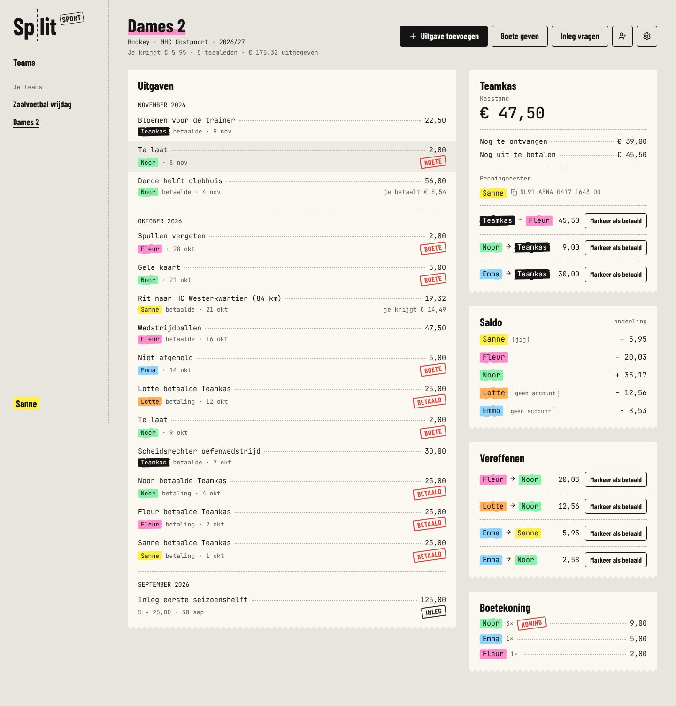
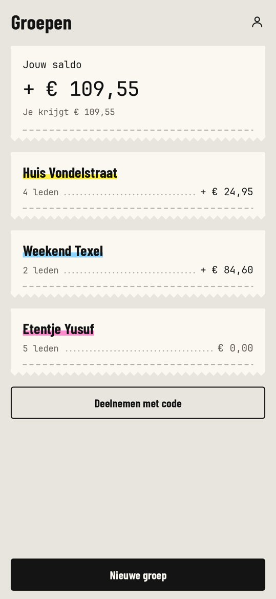
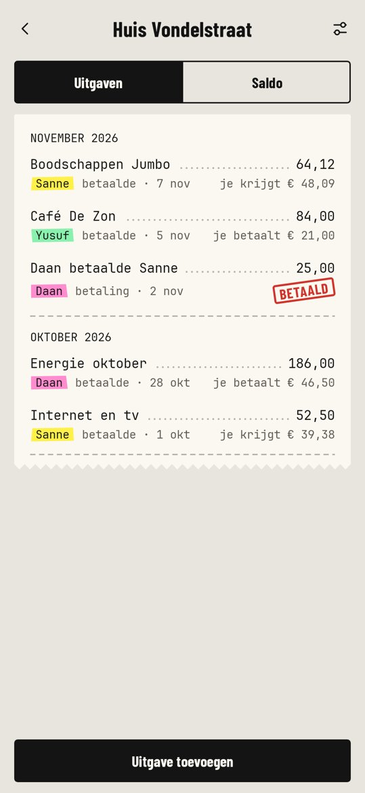
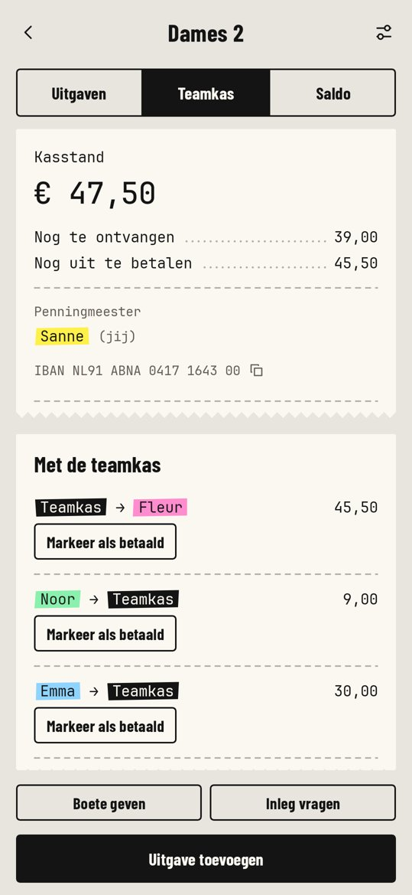
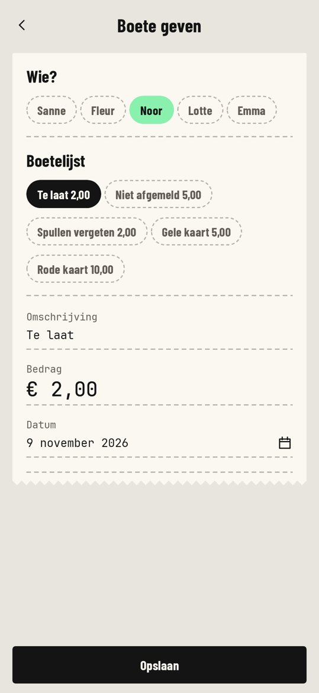

# Split Sport

## About this publication

This source code accompanies the AI Report masterclass on building software with AI.
You can study, run, fork and adapt the project under the [MIT license](LICENSE).
It is a masterclass example project; no hosted service or ongoing maintenance is offered.

The team pot, contributions, fines and shared expenses of a sports team, on one receipt. Split Sport
is adapted from Split for sports clubs. The original Split repository is not included
in this public selection; this repository contains the source needed for this version:

- **Teams** with a sport, a club and a season, instead of loose groups.
- **Teamkas**: every team has a pot with a treasurer (penningmeester). The app shows what is really
  in it (kasstand), what is still to come in and what the pot still owes.
- **Inleg**: ask everyone for a contribution in one go.
- **Boetes**: the team's own fine list, one tap to give a fine, and a fine ranking (boetekoning).
- **Uitgaven**: paid from the pot, advanced for the team, or shared among players, split equally, by
  amount, by shares or per receipt line (with receipt scanning), plus a ride calculator for away games.
- **Vereffenen**: first everyone squares up with the pot, then players among themselves.

One API, three clients:

| | Where | Stack |
| --- | --- | --- |
| API | [`apps/api`](apps/api) | Node 22, Hono, SQLite |
| Web | [`apps/web`](apps/web) | React, Vite |
| Android | [`apps/android`](apps/android) | Kotlin, Jetpack Compose |
| iOS | [`apps/ios`](apps/ios) | Swift, SwiftUI |
| Shared logic | [`packages/core`](packages/core) | TypeScript: splitting, balances, API types |

The interface is Dutch. The house style ("Kassabon": receipt paper, till numerals, one highlighter
per person) and the screens are described in [`docs/design.md`](docs/design.md), the REST API in
[`docs/api.md`](docs/api.md).



<p>
  
  
  
  
</p>

## Run it

You need Node 22 and [pnpm](https://pnpm.io) 10.

```bash
pnpm install
```

```bash
pnpm dev
```

This starts the API on http://localhost:8787 and the web app on http://localhost:5173. To get a
hockey team with a pot, contributions, fines and a few weeks of expenses to look at:

```bash
pnpm --filter @split/api seed
```

and log in as `sanne@example.nl` with the password `split-demo`.

Configuration is read from `apps/api/.env`; see [`.env.example`](.env.example). Without an Anthropic
API key everything works except "Bon scannen", which the clients then hide.

### Android and iOS

Each app has its own README: [`apps/android/README.md`](apps/android/README.md) and
[`apps/ios/README.md`](apps/ios/README.md). Both talk to the same API; in debug builds they point at
a server on your own machine, and the login screen has a "Server" field to change that.

## Checks

```bash
pnpm typecheck
```

```bash
pnpm test
```

The three clients each implement the split calculation for live previews (the server's result is
always the one that counts). [`spec/split-vectors.json`](spec/split-vectors.json) holds the test
vectors that the TypeScript, Kotlin and Swift implementations must all pass.

## Deploy

The API server also serves the built web app, so one process is the whole product:

```bash
pnpm build
```

```bash
pnpm start
```

Or as a container, with the SQLite database in the `/data` volume:

```bash
docker build -t split .
```

```bash
docker run -p 8787:8787 -v split-data:/data -e ANTHROPIC_API_KEY=… split
```

Put it behind a reverse proxy that terminates TLS and set `TRUST_PROXY=1`. The mobile apps need the
public URL as their server address (see their READMEs).

## How it fits together

- **Money** is integer cents everywhere; nothing is ever a float.
- **Team members** may or may not have an account, so you can add people by name and let them claim
  their name later with the invite link.
- **The pot is a member** of the team that is not a person. A contribution or a fine is an entry
  "paid" by the pot with a share for every charged member; paying the pot is a payment to it. One
  ledger therefore covers the pot and the players, and every balance splits into what a member has
  with the pot and with the others (`packages/core/src/balances.ts`).
- **Kasstand** counts only money that moved: payments into the pot, minus payments out of it and
  what the pot spent. An unpaid fine is a claim, not cash.
- **Settling up** first pairs every member with the pot, then suggests at most n−1 payments among
  the players by repeatedly matching the largest debtor with the largest creditor.
- **Receipt scanning** sends the photo to Claude with a structured-output schema
  (`apps/api/src/receipts.ts`) and returns the lines for the "Per regel" split. Photos are not stored.
