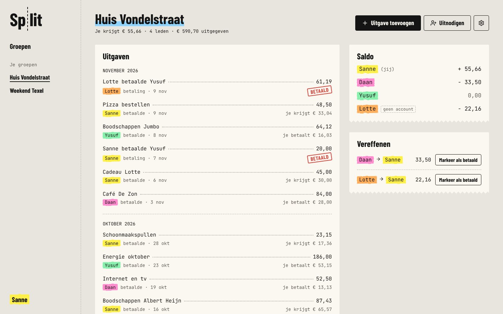
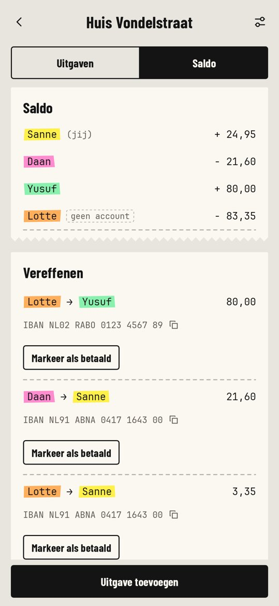
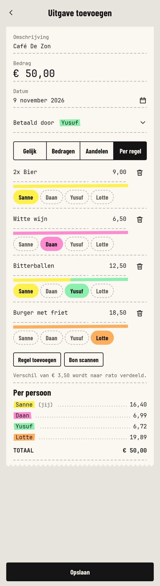

# Split

Keep track with your group of who paid what, and settle up in one go. Groups with a running balance
(house, holiday, dinner), expenses split equally, by amount, by shares or per receipt line, receipt
scanning, and suggested payments that bring everyone back to zero.

One API, three clients:

| | Where | Stack |
| --- | --- | --- |
| API | [`apps/api`](apps/api) | Node 22, Hono, SQLite |
| Web | [`apps/web`](apps/web) | React, Vite |
| Android | [`apps/android`](apps/android) | Kotlin, Jetpack Compose |
| iOS | [`apps/ios`](apps/ios) | Swift, SwiftUI |
| Shared logic | [`packages/core`](packages/core) | TypeScript: splitting, balances, API types |

The interface is Dutch. The house style ("Kassabon": receipt paper, till numerals, one highlighter
per person) and the screens are described in [`docs/design.md`](docs/design.md), the REST API in
[`docs/api.md`](docs/api.md).



<p>
  
  
  
  
</p>

## Run it

You need Node 22 and [pnpm](https://pnpm.io) 10.

```bash
pnpm install
```

```bash
pnpm dev
```

This starts the API on http://localhost:8787 and the web app on http://localhost:5173. To get a
group with a month of expenses to look at:

```bash
pnpm --filter @split/api seed
```

and log in as `sanne@example.nl` with the password `split-demo`.

Configuration is read from `apps/api/.env`; see [`.env.example`](.env.example). Without an Anthropic
API key everything works except "Bon scannen", which the clients then hide.

### Android and iOS

Each app has its own README: [`apps/android/README.md`](apps/android/README.md) and
[`apps/ios/README.md`](apps/ios/README.md). Both talk to the same API; in debug builds they point at
a server on your own machine, and the login screen has a "Server" field to change that.

## Checks

```bash
pnpm typecheck
```

```bash
pnpm test
```

The three clients each implement the split calculation for live previews (the server's result is
always the one that counts). [`spec/split-vectors.json`](spec/split-vectors.json) holds the test
vectors that the TypeScript, Kotlin and Swift implementations must all pass.

## Deploy

The API server also serves the built web app, so one process is the whole product:

```bash
pnpm build
```

```bash
pnpm start
```

Or as a container, with the SQLite database in the `/data` volume:

```bash
docker build -t split .
```

```bash
docker run -p 8787:8787 -v split-data:/data -e ANTHROPIC_API_KEY=… split
```

Put it behind a reverse proxy that terminates TLS and set `TRUST_PROXY=1`. The mobile apps need the
public URL as their server address (see their READMEs).

## How it fits together

- **Money** is integer cents everywhere; nothing is ever a float.
- **Members** belong to a group and may or may not have an account, so you can add people by name
  and let them claim their name later with the invite link.
- **Expenses and payments** share one table. A payment is an entry paid by the debtor with a single
  share for the receiver, so a balance is simply everything a member paid minus everything they owe.
- **Settling up** suggests at most n−1 payments by repeatedly matching the largest debtor with the
  largest creditor (`packages/core/src/balances.ts`).
- **Receipt scanning** sends the photo to Claude with a structured-output schema
  (`apps/api/src/receipts.ts`) and returns the lines for the "Per regel" split. Photos are not stored.
